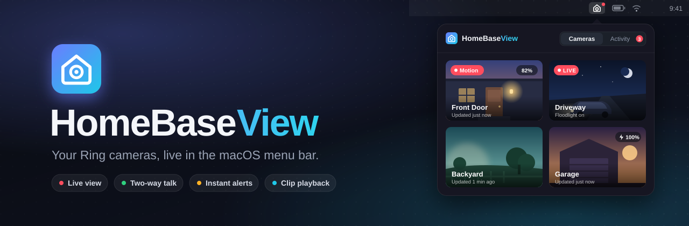
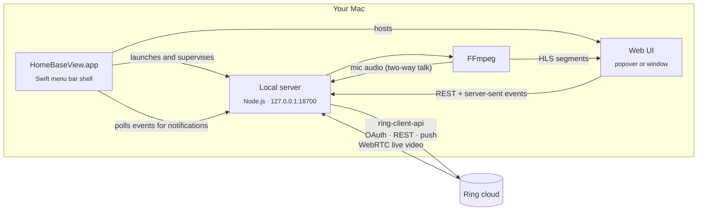

<p align="center">
  
</p>

<p align="center">
  
  
  
  <a href="LICENSE"></a>
  <a href="https://github.com/indieocean/homebaseview/commits/main"></a>
</p>

<p align="center">
  <b>HomeBaseView</b> is a small, open-source macOS app that puts your Ring doorbells and cameras one click away in the menu bar.<br>
  Watch live, talk to visitors, flip on the floodlight, and get a notification with a snapshot the moment someone is at the door.
</p>

---

> [!IMPORTANT]
> HomeBaseView is an independent project. It is **not affiliated with, endorsed by, or supported by Ring or Amazon**.
> It talks to Ring through the community-maintained [`ring-client-api`](https://github.com/dgreif/ring), which uses the same private API as the Ring mobile app.
> Ring can change that API at any time. Use it for your own cameras, at your own risk.

## Contents

- [Features](#features)
- [Quick start](#quick-start)
- [How it works](#how-it-works)
- [Usage](#usage)
- [Configuration](#configuration)
- [Privacy and security](#privacy-and-security)
- [Project layout](#project-layout)
- [Troubleshooting](#troubleshooting)
- [Contributing](#contributing)
- [Acknowledgements](#acknowledgements)
- [License](#license)

## Features

| | |
| --- | --- |
| 🎥 **Live view** | Low-latency video from any camera, with sound. Pop it out into a resizable window to keep watching. |
| 🎙️ **Two-way talk** | Speak to visitors through the camera's speaker using your Mac's microphone. |
| 🔔 **Instant alerts** | Native macOS notifications for doorbell presses and motion, with a snapshot attached. A red dot stays on the menu bar icon until you open the app. |
| 🔕 **Your call on alerts** | Turn banners, motion alerts and the red dot on or off from Settings or the menu bar icon's right-click menu. |
| 🧠 **Smart labels** | Ring's person, package, vehicle and animal detection, shown right in the activity log. |
| 🎞️ **Clip playback** | Replay recordings from the last 24 hours, then save them to Downloads or share them with AirDrop, Messages, Mail and more. Requires a Ring Protect plan. |
| ⛶ **Full screen** | Watch live video or a recording full screen with one click or a double-click. |
| 💡 **Device controls** | Toggle floodlights, sound the siren, and turn motion detection on or off. |
| 🔋 **Status at a glance** | Battery level, charging, offline and motion badges on every camera tile. |
| 🌗 **Feels native** | Light and dark mode, reduced-motion support, Launch at Login, and a popover you can drag into its own window. |

## Quick start

**Requirements:** macOS 14 Sonoma or later, [Node.js](https://nodejs.org) 20 or later, and the Xcode command line tools (`xcode-select --install`).

```sh
git clone https://github.com/indieocean/homebaseview.git
cd homebaseview
npm install
bash macos/build-app.sh --install   # builds HomeBaseView.app and copies it to /Applications
open /Applications/HomeBaseView.app
```

Click the house icon in the menu bar and sign in with your Ring email and password, then enter the code Ring texts or emails you.
No API key or developer account is needed.

> [!TIP]
> Drop `--install` to build into `macos/build/HomeBaseView.app` without touching `/Applications`.

### Run it in a browser instead

The server and web UI work on their own, without the menu bar app:

```sh
npm install
npm start -- --open
```

The terminal prints a one-time link with an access token. Opening it stores a cookie, so later visits to `http://127.0.0.1:18700` just work.

## How it works



- **Sign-in.** Your email, password and verification code go to Ring's OAuth endpoint. Only the resulting refresh token is saved, and Ring rotates it on every use.
- **Events.** Ring's push notifications arrive in real time. The server also polls Ring's event history every few seconds as a backup, and merges duplicates.
- **Recordings.** Clips stream through the local server, which forwards each byte-range request to Ring's signed download link. Ring's download host bakes the range into its redirects, so pointing the player at Ring directly would stall.
- **Live view.** The camera streams to the server over WebRTC through Ring's signalling service. FFmpeg repackages it as a short rolling HLS playlist that the UI plays with [hls.js](https://github.com/video-dev/hls.js).
- **Talk.** FFmpeg captures your default microphone and encodes Opus or G.711, depending on the camera. The audio goes back over the same WebRTC session.
- **Battery friendly.** A stream stops when you close the viewer or the popover, or after 30 seconds with nobody watching.

## Usage

| Action | How |
| --- | --- |
| Open the camera grid | Click the menu bar icon |
| Watch a camera live | Click its tile |
| Talk, light, siren, motion, save still | Buttons under the live video |
| See what happened | **Activity** tab, then click an event to play its clip |
| Control a recording | Click the video or press Space to play or pause, drag the scrubber, or press ← / → to skip 5 seconds |
| Full screen | Full screen button in the player's top bar, or double-click the video. Press Esc to exit. |
| Save or share a recording | Save (down arrow) or Share button in the player's top bar while a clip plays. Saved clips go to Downloads as `<camera> <date> <time>.mp4`. |
| Switch between grid and large tiles | Layout button in the top bar |
| Open a resizable window | Pop-out button in the top bar, or right-click the icon and choose **Open in Window** |
| Clear the red dot | Open the popover or window. If the dot was showing, the app opens on **Activity**. |
| Turn notifications on or off | Right-click the menu bar icon, then **Notifications**: Show Notifications, Alert on Motion, Red Dot on Menu Bar Icon, and a link to macOS Notification Settings. The same switches are in Settings. |
| Launch at Login, server log, restart | Right-click the menu bar icon |
| Refresh interval and other settings | Settings button in the top bar |

The first time you press **Talk**, macOS asks for microphone access for HomeBaseView.

## Configuration

Everything works out of the box. These environment variables are optional:

| Variable | Default | Description |
| --- | --- | --- |
| `HOMEBASEVIEW_PORT` | `18700` | Port for the local server |
| `HOMEBASEVIEW_POLL_MS` | `5000` | How often to poll Ring event history as a backup for push. Minimum 2000. |
| `HOMEBASEVIEW_CLIENT_NAME` | `HomeBaseView` | Name shown in the Ring app under Control Center, Authorized Client Devices |
| `HOMEBASEVIEW_DATA_DIR` | `~/.homebaseview` | Where tokens, logs and temporary video are stored |
| `HOMEBASEVIEW_VERBOSE` | unset | Set to `1` for detailed `ring-client-api` logging |

Run `npm start -- --new-token` to rotate the local access token.

## Privacy and security

HomeBaseView has no backend, analytics or telemetry. It only talks to Ring.

- **Local only.** The server listens on `127.0.0.1` and rejects requests addressed to any other host name, which blocks DNS-rebinding attacks.
- **Authenticated.** Every API call needs a random 256-bit token. The menu bar app reads it from disk, and the browser keeps it in an `HttpOnly`, `SameSite=Strict` cookie.
- **Owner-only files.** Everything is written with `0600` permissions inside `~/.homebaseview`:

  | File | Contents |
  | --- | --- |
  | `ring-token` | Ring refresh token |
  | `session-token` | Local access token for the UI and menu bar app |
  | `events.json` | Activity log for the last 24 hours |
  | `server.log` | Server log, rotated at 1 MB |
  | `hls/` | Live video segments, deleted when a stream stops and on every start |

- **Easy to revoke.** **Sign out** in Settings deletes the Ring token. You can also remove *HomeBaseView* from the Ring app under Control Center, Authorized Client Devices.

## Project layout

```
.
├── server/            Node.js server (ES modules, no build step)
│   ├── index.js         startup, shutdown, parent-process watchdog
│   ├── ring.js          sign-in, cameras, push + polled events, recordings
│   ├── streams.js       live view (WebRTC → FFmpeg → HLS) and two-way talk
│   ├── snapshots.js     cached camera stills
│   └── routes.js        REST API, server-sent events, auth
├── web/               UI served by the server (plain HTML, CSS, JS)
├── macos/             Swift menu bar app
│   ├── Sources/HomeBaseView/
│   ├── build-app.sh     builds and signs HomeBaseView.app
│   └── make-icon.swift  renders the app icon
└── docs/assets/       README artwork
```

## Troubleshooting

<details>
<summary><b>The Verify button says the code is wrong or expired</b></summary>

Codes expire after a few minutes, and a sign-in attempt is only kept for 10 minutes. Click **Start over** to get a fresh code.
</details>

<details>
<summary><b>Live view never starts</b></summary>

Check `~/.homebaseview/server.log`, which you can also open by right-clicking the menu bar icon and choosing **Show Server Log**. Battery cameras can take several seconds to wake up. Make sure nothing else is using port 18700.
</details>

<details>
<summary><b>Talk says the microphone is blocked</b></summary>

Allow HomeBaseView in System Settings, Privacy & Security, Microphone. Then quit and reopen the app.
</details>

<details>
<summary><b>No notifications</b></summary>

Right-click the menu bar icon and check **Notifications**. If it says *Turned off in System Settings*, choose **macOS Notification Settings…** and allow HomeBaseView. Also make sure **Show Notifications** is checked, and **Alert on Motion** if you want motion alerts and not only doorbell presses. Push from Ring can be delayed. The history poll catches anything push misses, usually within Ring's own 20 to 60 second lag.
</details>

<details>
<summary><b>A recording won't play</b></summary>

Ring needs a minute or two after an event to finish processing the clip, and recordings need a Ring Protect plan. If the player says the recording isn't available, wait and try again.
</details>

<details>
<summary><b>"Ring signed this Mac out"</b></summary>

Ring invalidates sessions when your password changes or the device is removed in Control Center. Sign in again.
</details>

## Contributing

[Issues](https://github.com/indieocean/homebaseview/issues) and [pull requests](https://github.com/indieocean/homebaseview/pulls) are welcome.

1. [Fork the repo](https://github.com/indieocean/homebaseview/fork) and create a branch.
2. Run the server with `npm start -- --open` and edit files in `web/` or `server/`. There's no build step, so just reload.
3. For the menu bar app, run `npm run app` and open `macos/build/HomeBaseView.app`.
4. Check syntax with `npm run check`, describe what you tested, and open a PR.

Please never include tokens, logs or camera images in issues.

## Acknowledgements

- [`ring-client-api`](https://github.com/dgreif/ring) by Dusty Greif and contributors, which does the hard work of speaking Ring
- [`hls.js`](https://github.com/video-dev/hls.js) for in-browser live playback
- [`werift`](https://github.com/shinyoshiaki/werift-webrtc) for WebRTC in Node.js
- [`ffmpeg-for-homebridge`](https://github.com/homebridge/ffmpeg-for-homebridge) for a ready-to-use FFmpeg build

## License

HomeBaseView is released under the [MIT License](LICENSE).

The built app bundles third-party software under its own licenses, notably Node.js and an FFmpeg build from `ffmpeg-for-homebridge`.
Review those licenses before you redistribute a built `HomeBaseView.app`. This repository contains source code only.

Ring is a trademark of Ring LLC, an Amazon company. It is used here only to describe compatibility.
